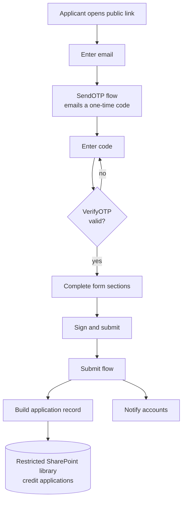
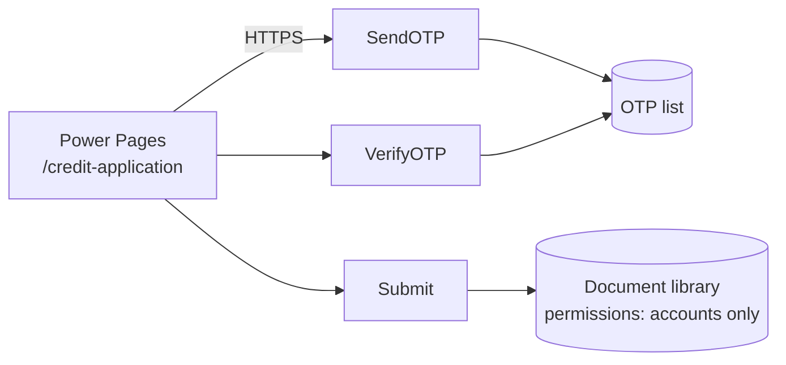

# Customer Credit Application Portal

A public online credit application form for a B2B services business, replacing a paper form. The applicant verifies their email with a one-time code, completes the application, signs it, and a PDF record is saved to a restricted SharePoint library for the accounts team.

> Case study. The production code, flows and data belong to my employer and are not published. This repository documents the design, architecture and decisions. All names and values shown are generic.

## Form sections

1. Business details
2. Accounts contact
3. Director or principal
4. Credit limit requested (14-day terms)
5. Bank details
6. Two or more trade references
7. Terms and conditions, declaration and signature

## Flow

## Architecture

## Handling sensitive data

- Bank details are kept only inside the saved application document. They are not written to list columns, so they never appear in list views or exports.
- The library is restricted to the accounts team and the service account. Access is controlled by permissions rather than file passwords, so nobody has to manage or share a password.
- The OTP step confirms the applicant controls the email address they give before anything is stored.

## Stack

Power Pages, Power Automate (three HTTP-triggered flows), SharePoint Online, Outlook.
